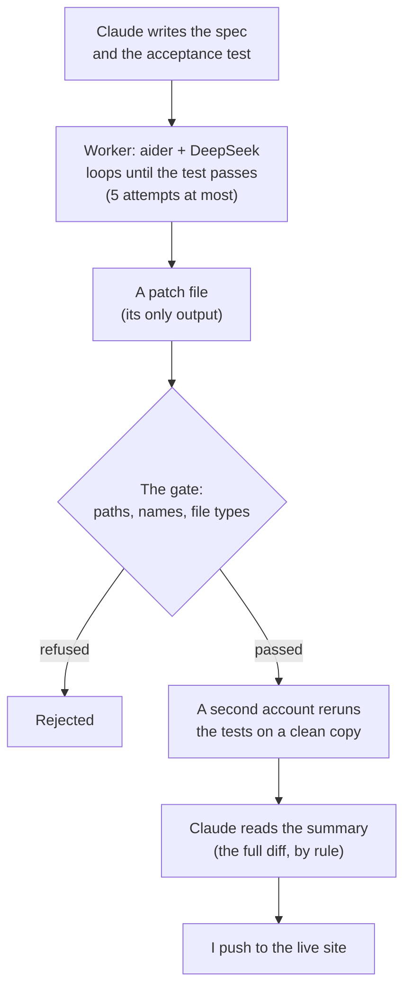
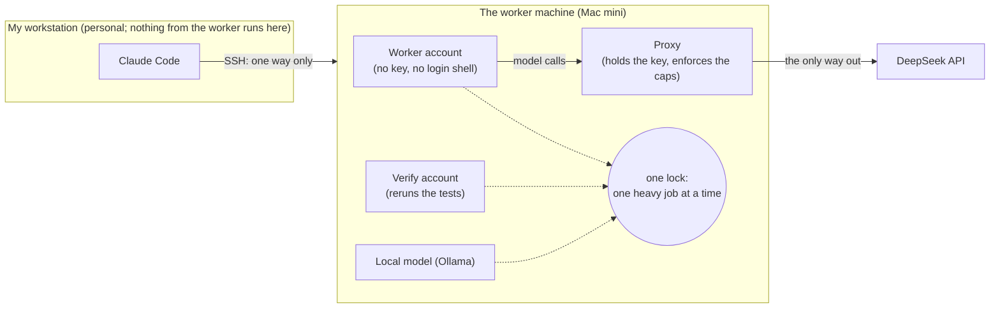
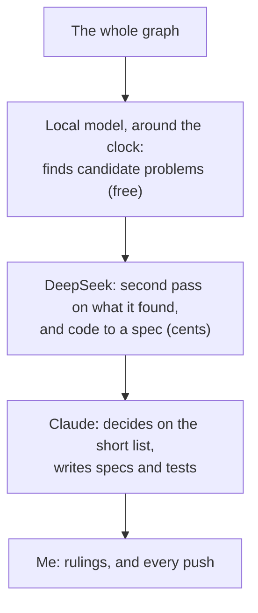

# A cheap model as a contractor: letting DeepSeek write code without trusting it

*Doug Egge, October 2026*

---

I run [bibleontology.org](https://bibleontology.org), a non-profit study site built on a knowledge graph of the
Bible, and I built it with Claude Code. While the site went up I paid for a month of Claude's **Max 5x** plan. Then I
dropped back to **Pro**, and found the site has grown large enough that a Pro allowance can't make much progress in
a week. Its server alone is 22,000 lines, so just reading enough of the code and data to change something safely
uses a real share of the allowance before the work starts.

So I asked [r/ClaudeCode](https://www.reddit.com/r/ClaudeCode/comments/1xk8imc/has_anyone_built_a_safe_autonomous_coding/) how others hand implementation to
a cheaper model without handing it the keys. The replies were better than anything I'd have designed alone. This is
what I built from them, what it cost, and what went wrong.

## The split

**Claude decides; DeepSeek types.** Claude (Opus) writes the task: what to build, which files, and the acceptance
test that defines "done". DeepSeek V4.1 Flash, driven by [aider](https://aider.chat), writes the code until that
test passes. Claude then decides whether to keep it.

One commenter put the economics well: if the expensive model reads every line the cheap one wrote, the savings
are gone. Another put the deeper reason better. A single agent whose goal is "finish the task" is biased toward
reporting success. Splitting the roles makes "done" someone else's call.

One job, end to end:

## Where the worker lives

The worker runs on a separate machine on my home network, under its own unprivileged account with no login shell.
It can't see my personal files, and my workstation is the machine it can't reach. Connections go one way only, from
my workstation to the worker machine. A daily check confirms that's still true.

**It never holds the API key.** A small local proxy holds it. The worker talks only to the proxy, and the proxy
forwards only to DeepSeek. The proxy also enforces the budget:

- **$5 a week,** across everything DeepSeek does for the project;
- **a smaller weekly cap** for the coding worker alone;
- **a token cap per job,** so one confused run can't eat the week.

A commenter's line stuck with me: *a sandbox limits what the worker can touch; the credential limits what it can
break.* Here the worker has neither the key nor a way to push. Its only output is a patch file.

Where everything runs, and which way connections go:

## What it sees

The worker gets an export of one exact commit, cut to an allow list: source, tools and tests. The project's private
notes, its review records and anything readers have written never leave my machine. A file that *looks* like it holds
a secret is left out even if it's on the allow list. Some tests plant fake keys to prove the scanners work, so those
tests are left out too.

## It can't change what "passing" means

This was the sharpest question in the thread: *if the worker can edit the tests, rerunning them tells you nothing.*

- **The acceptance tests are written first** and shipped read-only, outside the worker's write access.
- **A patch that touches one is refused** before anything runs.
- **A patch that adds anything new under the tests folder** gets read line by line, because a helper a test
  imports could fake a pass.

## The gate

Every patch passes a deterministic gate before a person or model reads it. The gate takes the list of files from
git's own parser of the patch, not from the patch's headers. It refuses:

- sensitive paths;
- files Python would run at start-up, and files that would shadow a standard-library module;
- links, executables and binaries;
- names that change under Unicode normalization.

Five failed attempts end the job as "spec too vague". That's my failure, not the model's.

## It never says "tests pass" on its own behalf

The worker's own report is a claim. A second unprivileged account on the same machine applies the patch to a clean
copy and reruns the tests. My workstation never runs the worker's code at all.

What Claude reads is a short summary: the gate's verdict, the size of the change, the attempts used, the tokens and
dollars spent, and the second account's test result. It reads the full diff only by rule: after two failed
attempts, near sensitive files, for code that can launch processes or reach the network, or for text the site shows
readers.

## A security reviewer that never stops asking

None of the above was designed in one pass. I keep a **security reviewer**: a Claude persona whose only job is to
attack my setup. It does regular checkups of my environment and a full review whenever the architecture changes.
Adding the worker was the biggest such change so far, and it got two adversarial reviews: one of the design, and a
re-test of the built system before anything ran on it.

The flavor of what it asks:

- **Trust nothing the worker writes, including its file list.** The first gate read the changed files from the
  patch's own headers. The reviewer built a patch with a section that had no header: invisible to the gate, but
  applied by git. The gate now takes its list from git's own parser and refuses a patch where the two disagree.
- **Check the boring paths.** Could the worker's account read my home folder? Log in interactively? Reach anything
  but the proxy? Each became a check rather than an assumption.
- **Who writes the shared state?** The lock that pauses the local models is written by the very account being
  contained, so the reviewer forged one and showed it could starve the local batch or crash it in a loop. Now
  the lock is believed only while its owner is alive and its deadline hasn't passed.
- **Turn every finding into a test.** A finding that stays in a review document is forgotten by the next change.
  The worker's own suite now plants 211 faults it must catch, and runs on every change to the worker.

The reviewer also wrote a **threat model** for my whole working environment. My personal machine is the one that
matters most, because a compromise there is a compromise of me, not just the site. The model's checks became a
**daily scan**: deterministic, no model, just a script. It compares what's installed against yesterday, checks
that the scripts on the worker machine still match the reviewed copies, and checks that the worker machine still
can't open a connection back to my workstation. It runs every day and tells me only when something changed.

## What it cost, and what went wrong

**The first pilot** added batching to a search-engine notification script. One attempt, 20,795 tokens, **$0.0044**. Claude
read a 16-line diff and kept it.

**The second pilot** fixed one British spelling in a 22,000-line server file. It hit the per-job token cap: 697,031 tokens,
**$0.108**, over 2 calls. Two lessons, both mine:

1. **The test was wrong.** It counted docstrings as text the site shows, so it couldn't pass without breaking the
   spec. A cheap model on an unpassable test just burns tries.
2. **Big files are expensive.** The model re-read the whole file on every call.

What I do now: **prove each acceptance test passable before the worker sees it,** by running it against a throwaway
minimal solution. A test also has to catch a set of deliberately planted faults. Otherwise a test that passes
everything looks exactly like one that works.

**The I AM card** was the first real feature. The site's card for the title "I AM" lists every place the original
Hebrew or Greek has the words: 56 of them, from the burning bush to the man born blind saying the same two Greek
words (John 9:9). Claude built the data from the graph and wrote the acceptance test: every verse shown, nothing
invented, every string escaped, no picture of a person. DeepSeek wrote the face.

- **The first run produced nothing:** 125,267 tokens, **$0.035**, 5 of 5 attempts failed. My proxy capped each reply
  at 8,000 tokens, and the model spent all of it reasoning aloud before the code, so the code was cut off every
  time. On the token-limit error, aider also tried to open its help page in a browser. The worker's account has no
  desktop, so that went nowhere. It's now switched off outright.
- **The fix was mine:** raise the reply ceiling to 64,000 (DeepSeek accepts far more; the dollar caps do the real
  limiting), ask for whole files, and say "reply with the file only."
- **The second run passed** on its last attempt: 202 lines, 167,472 tokens, **$0.039**.
- **The follow-up** (a name plate, and a test tightened to require it) passed on its first attempt: **$0.0098**.

So a 200-line feature cost under a dime, and most of that was spent learning my own setup's limits.

The pictures went differently. DeepSeek, in thinking mode, drew five candidate line sketches for about **2.3¢**
together, and four of them were kept. The bush was hardest. The version that shipped was traced by hand from a
draft made in another tool. The cheap model is a good draftsman, not an illustrator.

## Around the clock, with local models

The worker machine is a Mac mini, and it has a second job: running **local models** all day and all night. A
mid-sized open model on Ollama works through the whole graph in long batches. It doesn't change anything; it looks
for problems, such as a relation whose verse doesn't say what the relation claims, or two layers of the graph that
disagree. It costs nothing per token, so it can afford to be patient.

The three tiers each do what they're cheapest at:

- **The local model finds candidates,** around the clock, for nothing.
- **DeepSeek takes a second pass** on what the local model surfaced, or does a job like the ones above, for cents.
- **Claude decides,** on the short list that's left, and writes the specs and tests.

They share the machine politely. When a DeepSeek job needs memory to run its tests, it takes a lock; the local
batch pauses, and resumes when the lock is released. A crashed job
can't stall the batch, because the lock carries its owner and a deadline.

The goal is continual improvement that doesn't wait on me. The site gets checked every hour of the week, and my
expensive allowance goes only to the judgments that need it.

## Two models, one machine, and who decides

Below Claude, there are two models to choose from:

- **The local model,** on the Mac: free to run and never sleeps, but slower and less capable. Right now it's a mid-sized
  open model. When a new one comes out that fits in the same memory, it has to earn its place: it's scored on
  verses whose answers are already settled, with known faults planted among them.
- **DeepSeek V4.1 Flash,** over the API: much more capable, and costs money, a few cents a job. Its "thinking" mode
  is better still on hard problems, and slower and pricier, so it has to be granted.

**Claude sets each job's budget when it writes the spec,** because that's when it knows the work best. Every job goes
out with:

- **a token cap,** so a confused run stops instead of burning the week;
- **at most five attempts;**
- **an output form** (a whole new file, or edits to an existing one);
- **a yes or no on thinking mode.**

The test is whether reasoning would change the answer. A file written to a precise spec doesn't need it. Drawing a
picture did: the five sketches on the site's cards were drawn in thinking mode, for about 2¢ together. For now Claude still asks me before any job thinks. It's my money on the line, though I may relax that once the
spending has a track record; that's where this is heading, not where it is. My
weekly cap sits above all of it, enforced by the proxy, not by anyone's judgment. Claude spends within it, and tells
me when a job wants more.

Only one heavy thing runs on the Mac at a time, so each piece of work goes to one model or the other. The
rules I've settled on:

- **If the local model is good enough, it gets the work.** Bulk checks, and first passes over the whole graph.
- **Accuracy beats speed, within reason.** Twice as slow for a small gain is a no. Twice as slow for a jump like going
  from a small model to a mid-sized one is a yes.
- **DeepSeek gets what the local model can't do well, or what can't wait:** second passes on what the local model
  surfaced, and code to a spec.
- **The money is paced, not spent.** $5 a week is the cap. The day's allowance is what's left divided by the days
  left. Cheaper off-peak hours come first. Hard, important work, like the cards for God, Jesus, the Holy Spirit and
  the Father, may borrow ahead within the week. Work that can't be afforded today waits in a queue rather than being
  dropped.

Today I make those calls by hand with Claude. The next step moves the routine ones onto the Mac. **An orchestrator,
using DeepSeek itself to judge how hard each job is,** will tag work by urgency and difficulty. It will keep the
local model busy from a standing backlog whenever nothing else needs the machine, and send DeepSeek only what earns
it. It schedules; it never applies anything. Every result still comes back through the same gate, the same second
test run, and me.

## What the thread changed

- **A token budget per step,** not just per job and per week. That would have stopped the second pilot sooner.
- **Workflows written by a person,** not invented by the agent. The orchestrator I'm building next picks which
  recipe to run and when, and never makes one up.
- **Fix the factory before you scale it.** One worker, one job at a time, until the lessons above stop arriving.

## What I'd tell someone starting

- **The spec and its test are where the cost is decided.** Spend the expensive model there.
- **Treat the worker's report as a claim.** Rerun the tests somewhere it can't touch.
- **Keep the key out of its reach.** A proxy is a few dozen lines.
- **Write down every failure with its number.** Mine are above.
