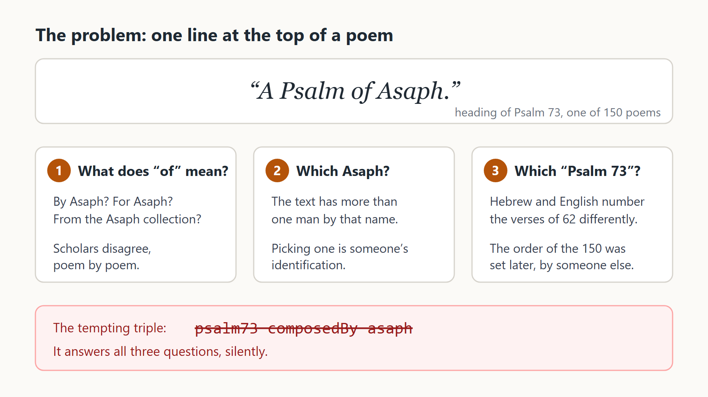
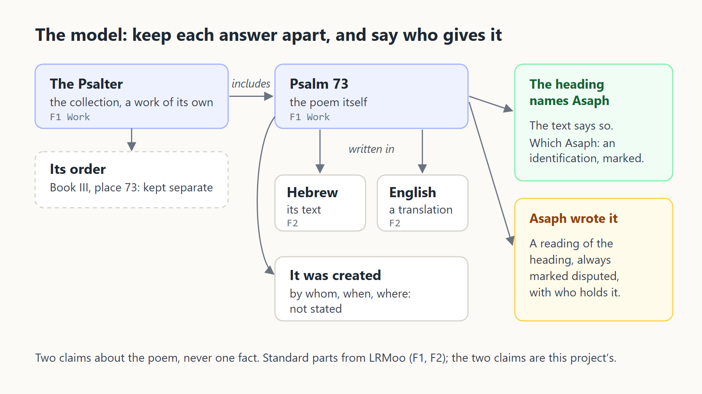

# Who wrote Psalm 73? Modeling the Psalter with LRMoo without answering the question

*Doug Egge, November 2026*

---

I run [bibleontology.org](https://bibleontology.org), a non-profit study site built on a knowledge graph of the
Bible. I'm a software architect, not a librarian or a biblical scholar, and this is the first part of the graph
where I had to model *the text itself* rather than what the text talks about. I'd like to describe the problem, the
model I landed on, and where I'm unsure, because I expect people who know LRMoo and FRBR better than I do will see
things I've missed.

Everything here is published: the vocabulary at [bibleontology.org/ns/biblio](https://bibleontology.org/ns/biblio)
(version 1.4.0), its SHACL shapes in [/ns/shapes](https://bibleontology.org/ns/shapes), and the data as
[`out/export/psalter.nt.gz`](https://github.com/bibleontology/bibleontology/raw/main/out/export/psalter.nt.gz),
22,431 triples, CC BY 4.0, described in the repository's VoID file.

## The problem



Psalm 73 opens with a line most English Bibles print in small type: "A Psalm of Asaph." The rest of the graph is
built from claims, each with its verses, its certainty and whose voice it is (the narrator's, a character's, or a
later reader's). So the obvious move is a triple:

```
psalm73  composedBy  asaph .
```

That triple is wrong in three ways I care about.

1. **"Of Asaph" may not mean "by Asaph."** The Hebrew preposition in these headings can mark an author, a collection
   ("from the Asaph collection") or a dedication. Scholars disagree, psalm by psalm. A plain triple settles it.
2. **Which Asaph?** The graph holds more than one person by that name. Picking the singer of 1 Chronicles is an
   identification someone makes; the heading doesn't make it.
3. **What is "Psalm 73"?** The Hebrew and the English are not the same object. In 62 psalms the verse numbers
   differ, mostly because the Hebrew counts a heading as a verse of its own where the English folds it into verse 1. The English is a translation, made from a
   particular Hebrew text, and it sometimes follows other witnesses instead. And the Psalter's order, with its five
   books, is an arrangement made by someone, later.

I wanted a model where the graph can say all of that without asserting any of the disputed parts.

## Why LRMoo

[LRMoo](https://cidoc-crm.org/extensions/lrmoo/) (version 1.1.1), the object-oriented form of IFLA's Library
Reference Model, separates exactly the layers I was mixing up:

- **F1 Work**: the intellectual creation, independent of any particular text. LRMoo's own examples include Homer's
  *Odyssey*, an ancient work with no surviving original. That was reassuring.
- **F2 Expression**: a specific realization in signs: the Hebrew text, or the English translation.
- **F3 Manifestation**: an edition or dataset that carries an Expression: MACULA's Hebrew dataset, the Berean
  Standard Bible's text.

I built a one-psalm pilot first (Psalm 73) and validated it with SHACL. Then, before writing a vocabulary, I went
back and read LRMoo's scope notes for every term the pilot used, not just their domains and ranges. That reading
changed the model, which I'll come to.

## The model



For each of the 150 psalms:

```turtle
r:work/psalm-73  a lrmoo:F1_Work ;
    rdfs:label "Psalm 73"@en ;
    lrmoo:R3_is_realised_in  r:expr/psalm-73-hebrew, r:expr/psalm-73-bsb .

r:expr/psalm-73-hebrew  a lrmoo:F2_Expression ;
    rdfs:label "Psalm 73 in Hebrew (MACULA Hebrew, after the Westminster Leningrad Codex)"@en ;
    dcterms:language "hbo" .

r:expr/psalm-73-bsb  a lrmoo:F2_Expression ;
    rdfs:label "Psalm 73 in English (the Berean Standard Bible)"@en ;
    dcterms:language "en" ;
    biblio:translationOf  r:expr/psalm-73-hebrew .

r:man/macula-hebrew  lrmoo:R4_embodies  r:expr/psalm-73-hebrew .
r:man/bsb            lrmoo:R4_embodies  r:expr/psalm-73-bsb .

r:event/psalm-73-creation  lrmoo:R16_created  r:work/psalm-73 .
```

A few decisions in there:

- **The English is a second Expression of the same Work, not a new Work.** LRMoo's F2 scope note says a difference
  in language makes a different Expression and names translation; R3's own example is a German translation
  realizing the original's Work.
- **`biblio:translationOf` is declared `rdfs:subPropertyOf lrmoo:R76_is_derivative_of`.** LRMoo types a derivation
  as a translation through `R76.1 has type`, a property of a property, which in RDF needs CIDOC's reification
  classes. A subproperty lets anyone reading the data as LRMoo see the derivation without that machinery.
- **Every Work has a creation event with no agent, no date and no place.** LRMoo requires the event (R16), and the
  creator is reached only through it (`P14 carried out by`). Leaving P14 off says nothing about authorship, which is
  exactly what I want the base layer to say.

The verses are segments of each Expression, numbered in that text's own scheme, and every verse of each is aligned to
the verse or verses of the other it corresponds to. Across the Psalter that is 2,527 Hebrew verses and 2,461 English
ones. Usually it's one to one. In Psalm 51, two verses of Hebrew heading plus the first line are all English 51:1, so
there it's many to one. In Psalm 13 it runs the other way: one Hebrew verse is two English verses (13:5 and 13:6).

## The Psalter, and a wrong turn

The Psalter is a Work too, with its own two Expressions. My pilot said the Psalter `R67_has_part` Psalm 73. On domain
and range alone that looked right, and an earlier review even called it "the right correction" over `R10`.

Reading R67's scope note changed my mind. R67's parts are "conceived at some point in time to form together a
logical whole", like the books of a trilogy. Psalm 73 was not composed as part of the Psalter; it was collected into
it. Stating R67 would assert a composition history the text doesn't establish, and whether the Psalter was shaped as
a whole is a live scholarly question.

So the Psalter's Expressions **`R75_incorporates`** each psalm's Expression instead: an Expression that includes
another while that one "realises a different instance of F1 Work". LRMoo's examples are a recording that incorporates
Schiller's poem. A collected psalm fits that exactly, and R75 takes no position on how unified the collection is.
The Psalter Work gets its own creation event, standing for the compiling, also with no agent.

The order isn't in LRMoo at all. It's a `biblio:Arrangement` (here, the Masoretic order) with five
`biblio:Section`s, Book I (1–41) through Book V (107–150), and one entry per psalm with its position. If I add the
Septuagint's numbering later, it is a second arrangement, not a correction to the first.

## The headings, as claims

This is the part I care about most. The heading claims live in the graph's claim layer, never as plain triples. For
each heading that names someone, there are two claims:

```turtle
r:claim/psalm-73-superscription  a claim:Claim ;
    claim:subject   r:work/psalm-73 ;
    claim:relation  biblio:superscriptionNames ;
    claim:object    e:asaph_singer ;
    claim:certainty claim:conjectured ;
    claim:voice     voice:reader/editors ;
    claim:verse     <https://bibleontology.org/p/Ps.73.1> ;
    rdfs:label "The superscription of Psalm 73 names Asaph; which Asaph the graph holds is the editors' identification"@en .

r:claim/psalm-73-composer  a claim:Claim ;
    claim:subject   r:work/psalm-73 ;
    claim:relation  biblio:composedBy ;
    claim:object    e:asaph_singer ;
    claim:certainty claim:disputed ;
    claim:voice     voice:reader/editors ;
    claim:verse     <https://bibleontology.org/p/Ps.73.1> ;
    rdfs:label "Asaph composed Psalm 73: a reading of the superscription, which may name an author, a collection or a dedication"@en .
```

The policy, applied across all 150 psalms:

- **Who the heading names.** Where the graph holds exactly one person of that name (David, Solomon, Moses), the
  heading naming them is the narrator's claim and explicit: the text states the name. Where it holds several (Asaph,
  Heman, Ethan), choosing one is the editors' identification, so it's conjectured.
- **Who composed it.** Always the editors' reading, and always disputed, for the reasons above.
- **The sons of Korah** (11 psalms) are held back: the graph has no record for them as a group, and the closest
  record is Korah himself, which would be the wrong person. Better to publish nothing than point at him.
- **What's counted but not published:** a heading's kind ("Maskil", "Miktam"; 93), its directions ("For the
  choirmaster"; 83) and its occasions ("when he fled from Absalom"; 11). There's no approved term for them yet, so
  they are measured, not published.

That's 180 claims in all, two for each of 90 attributions.

## How it's checked

Every part of this is checked by SHACL shapes and by tests that run before anything is published:

- **The vocabulary**: 19 terms. A test fails if a term is used in the data and not defined, or defined and never
  used. Its shapes catch 13 of 13 deliberately planted faults.
- **The Psalter**: the whole build must conform to the published shapes; the counts, the five books and the
  alignment must hold, and so must the heading policy. 7 of 7 planted faults are caught: R67 between the Psalter and
  a psalm, a psalm with no creation event, a psalm in the wrong book, a Hebrew verse aligned into another psalm,
  authorship stated as a plain triple, Asaph's identification given as the narrator's, and an English verse with
  nothing aligned to it.
- **The pilot**: 6 of 6.

I trust a check only after I've seen it fail on purpose, so each rule comes with a fault planted to prove it bites.

The build also found a bug on the live site. Building the alignment meant the code refused any verse mapped outside
its own psalm, and it refused one: the second verse of Psalm 54's heading (the Ziphites telling Saul where David was
hiding) had been shown on the site under Psalm 53:6. The verse map was fixed, and a test now refuses a psalm verse
mapped into another psalm.

## What it doesn't do (yet)

- **Only the Psalter.** The rest of the canon as Works is the next step, decided book by book.
- **One Hebrew witness.** The Hebrew is MACULA's, after the Leningrad Codex. The Septuagint, the Dead Sea Scrolls and
  other witnesses aren't modeled yet. When they are, each is another Expression of the same Work.
- **The English's source, per verse.** `translationOf` points the Berean at the Masoretic Hebrew, which is its base
  text. Where the Berean follows the Septuagint or the Dead Sea Scrolls instead (its footnotes say where), the source
  is a different Expression. That's a claim per verse, not modeled yet.
- **Not on the site's pages yet.** The data and vocabulary are published; a card that shows a psalm as a Work is
  still being designed.
- **Not built for inference.** Every vocabulary states a reasoning policy in its own description: the terms
  describe the graph and aren't built for automated inference over it. Every relation is a claim with its verse, its
  certainty and its speaker, and a reasoner that ignores those turns a character's claim into the narrator's, or a
  reading into a fact. So there's no `owl:sameAs` between records, no functional kinship, and no transitive
  chaining.

## What I'd like to know

I'd value corrections from anyone who works with LRMoo, FRBR or CIDOC CRM:

1. **R75 for a collection.** Is `R75_incorporates` the right relation between a collection's Expression and the
   Expression of a work collected into it, when that work was composed independently? Or is there a better pattern
   for anthologies that I've missed?
2. **The empty creation event.** Is an `F27 Work Creation` with no actor, time-span or place a reasonable way to say
   "this Work was created, and we make no claim about by whom"? Or does it read as an assertion of ignorance that a
   consumer might misuse?
3. **The subproperty of R76.** Is declaring `translationOf` a subproperty of `R76_is_derivative_of` a fair shortcut
   around `R76.1 has type`, or does it lose something people rely on?
4. **Attribution outside LRMoo.** LRMoo has no idea of an attributed or disputed author; I kept attribution entirely in
   a separate claim layer. Is there an existing pattern for this I should conform to?

The vocabulary page is at [bibleontology.org/ns/biblio](https://bibleontology.org/ns/biblio), and the data and its
VoID description are in the [public repository](https://github.com/bibleontology/bibleontology). The project is free
and non-profit. Thanks for reading, and for anything you can tell me.
